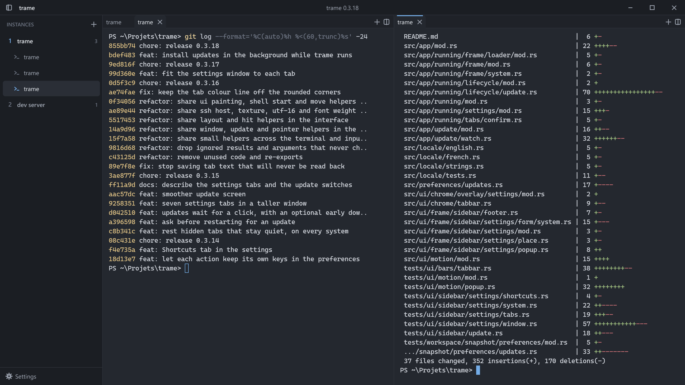
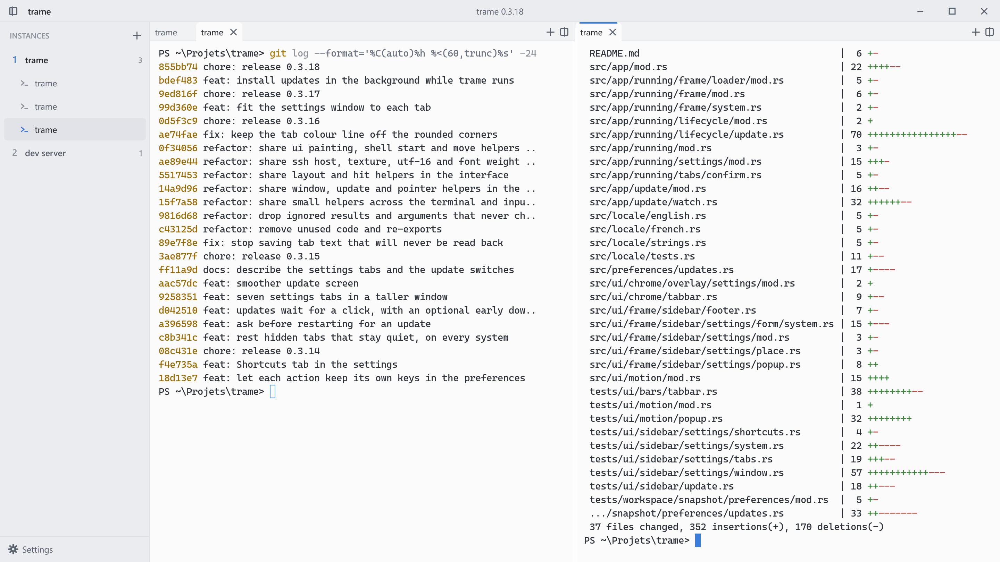

<p align="center">
  
</p>

<h1 align="center">trame</h1>

<p align="center">
  A light, fast terminal for Windows, Linux and macOS.<br>
  Your shells live in instances, tabs and splits, and they are all still there tomorrow.
</p>

<p align="center">
  <a href="https://github.com/LetermeFlorent/trame/releases/latest"><b>Download</b></a>
  ·
  <a href="GUIDE.md">Guide</a>
  ·
  <a href="#build-it-yourself">Build it yourself</a>
</p>

<p align="center">
  
</p>

## One window per project, without the windows

Every project gets an instance: a named group of shells with its own tabs and its own splits. Instances stack up in a side bar you can widen, shrink or fold into a rail of icons. Click "dev server" and its tabs come back exactly as you left them; click "trame" and you are back in the other one. Nothing gets lost in a pile of identical windows.

Close trame tonight and open it tomorrow. Each shell reopens in its folder, each tab shows the text it held, with its colours, and SSH tabs reconnect.

## What you get

The everyday things are a drag or a double click away:

- drag a tab onto another pane to join it, onto its edge to split it, or onto an instance to move it there;
- name and colour any tab or instance, give each instance its own icon and folder;
- save SSH connections once and open them in a tab with one click, with the password kept in the Windows Credential Manager;
- remap every shortcut from the settings, with up to four keys per action;
- pick French or English, the text size and the interface scale from 80% to 150%;
- leave it open all day: hidden tabs slow down and give memory back, and a minimized window draws nothing at all.

<p align="center">
  
</p>

The theme follows your system and switches the moment it does. Above is the same window in light mode.

## Small, native and quick

trame is a single program of under 7 MB, written in Rust from the escape sequence parser up. It draws through the graphics card with DirectX 12, Metal or Vulkan, opens in a blink and starts the shell your system already uses: PowerShell 7 or Windows PowerShell on Windows, your `$SHELL` everywhere else.

It also tells you when a new version is out. Nothing installs on its own: one click on the update button, and trame restarts on the new version with your tabs back. On Linux, and on Windows when trame is installed for all users, it also asks for your password or administrator rights.

## Get it

Grab the file for your system from the [latest release](https://github.com/LetermeFlorent/trame/releases/latest).

| System | File |
| --- | --- |
| Windows 10 and 11 | `trame-<version>-setup.exe`, no administrator rights needed, or `trame.exe` to run without installing |
| Debian, Ubuntu | `trame_<version>-1_amd64.deb` |
| Fedora and other RPM systems | `trame-<version>-1.x86_64.rpm` |
| macOS 12 or newer, Apple Silicon and Intel | `trame-<version>-macos.zip`, then drag `trame.app` into Applications |

The Mac app has no Apple Developer ID, so macOS refuses its first launch: open it once from System Settings, Privacy & Security, Open Anyway. The [guide](GUIDE.md#install) has the details for each system, the keyboard shortcuts and everything else.

## Build it yourself

You need Rust 1.87 or newer.

```sh
git clone https://github.com/LetermeFlorent/trame.git
cd trame
cargo build --release
```

The program lands in `target/release`. Packaging and releasing are described in the [guide](GUIDE.md#build-from-source).

## License

MIT, see [LICENSE](LICENSE). trame is free to use and to change.
